# Lab 2: gNB TDD Traffic Analysis

## 1. Goal

In this lab, you will compare three 5-second UDP iperf3 tests. You will learn how TDD slot allocation can affect downlink and uplink performance.

You will also read the broadcast TDD configuration from SIB1 in Wireshark, draw the downlink/uplink time allocation, and relate the configuration to the iperf3 results.

You do not need to understand every packet. Follow the steps, complete the tables, and answer the short questions.

## 2. Test Scenarios and Files

| Scenario | TDD setting | Traffic direction | Main idea |
| --- | --- | --- | --- |
| A | DL-heavy | Downlink | The TDD setting favors the traffic direction |
| B | DL-heavy | Uplink | There are fewer opportunities for uplink traffic |
| C | Balanced | Uplink | More uplink opportunities are available than in B |

[Download the lab files from Google Drive](https://drive.google.com/drive/u/0/folders/1gTgosNkWFuak_sXbHFTxqaRqXb15Wz9T).

### Two Types of Packet Captures

Two types of packet captures are provided in this lab:

- **Configuration captures:** Recorded separately during initial cell access to show the broadcast SIB1 messages for the two TDD settings. Use these files to read and draw the common TDD configuration. Only two configuration captures are required because Scenarios A and B share the DL-heavy setting.
- **Scenario captures:** Recorded during the iperf3 tests. Use these files to analyze user-plane packets and the TCP control connection. Separate captures are provided for A, B, and C because each scenario uses a different combination of TDD setting and traffic direction.

The configuration captures are reference recordings for the corresponding settings, not simultaneous recordings of the original iperf3 runs. The scenario-to-configuration mapping below is supplied by the instructor; it cannot be established from the iperf3 JSON alone. Configuration captures are not used to calculate test throughput, loss, jitter, RTT, or packet intervals.

### Configuration Captures — Task 4 Only

| TDD setting | Applies to | Configuration capture |
| --- | --- | --- |
| DL-heavy | Scenarios A and B | `tdd-dl-heavy-sib1.pcapng` |
| Balanced | Scenario C | `tdd-balanced-sib1.pcapng` |

### Performance Files — Tasks 1–3 and 5–8

| Scenario | iperf3 JSON | Scenario capture |
| --- | --- | --- |
| A | `scenario-a-downlink.json` | `scenario-a-dl-heavy-downlink.pcapng` |
| B | `scenario-b-uplink.json` | `scenario-b-dl-heavy-uplink.pcapng` |
| C | `scenario-c-uplink.json` | `scenario-c-balanced-uplink.pcapng` |

> The JSON files report the traffic direction and performance results. They do not contain the gNB TDD configuration. Use the configuration captures for SIB1 and the scenario captures for traffic analysis.

## 3. Task 1 — Confirm the Traffic Direction

Open each JSON file and find:

```text
start → test_start → reverse
```

- `reverse: 1` means downlink in this lab.
- `reverse: 0` means uplink in this lab.

Complete the table:

| Scenario | Reverse value | Direction |
| --- | ---: | --- |
| A |1 |downlink |
| B |0 |uplink |
| C |0 |uplink|

**Question:** Does the traffic direction shown in the JSON match the scenario description? Show the proof.
- Yes. Scenario A has `reverse: 1`, which indicates downlink, while Scenarios B and C have `reverse: 0`, which indicates uplink. These values match the directions in the scenario table.

## 4. Task 2 — Compare Throughput

In each JSON file, find:

```text
end → sum → bits_per_second
```

Convert the value to Mbps:

```text
Throughput (Mbps) = bits_per_second ÷ 1,000,000
```

Complete the table:

| Scenario | Direction | Throughput (Mbps) |
| --- | --- | ---: |
| A | Downlink | 90.654 Mbps|
| B | Uplink | 109.117 Mbps|
| C | Uplink | 124.416 Mbps|

Calculate how much C improves over B:

```text
Improvement (%) = (C - B) ÷ B × 100
```

Answer: 

1. What is the downlink throughput in Scenario A?
- 90.654 Mbps
2. What is the uplink throughput in Scenario B?
- 109.117 Mbps
3. Is the uplink throughput higher in B or C?
- Scenario C is higher: 124.416 Mbps compared with 109.117 Mbps in B.
4. By approximately what percentage does C improve over B?
- C improves over B by approximately 14.02%: `(124.416 - 109.117) / 109.117 × 100`.

> Use the JSON `bits_per_second` value. Do not recalculate throughput using the other time fields.

## 5. Task 3 — Check the Trade-off

In each JSON file, find:

```text
end → sum → lost_percent
end → sum → jitter_ms
```

Complete the table:

| Scenario | Throughput (Mbps) | Packet loss (%) | Jitter (ms) |
| --- | ---: | ---: | ---: |
| B | 109.117| 0.23565 | 0.11619|
| C |124.416 | 2.133| 0.1620|

Answer:

1. Does C have higher uplink throughput than B?
- Yes
2. Does C have lower packet loss than B?
- No
3. What trade-off, if any, is visible when changing from B to C?
- C has higher throughput (124.416 vs. 109.117 Mbps), but also higher packet loss (2.133% vs. 0.23565%) and jitter (0.1620 vs. 0.11619 ms). The measurements show a throughput-versus-quality trade-off; they do not prove that the TDD configuration alone caused the differences.


Use the measured values. If one result improves while another worsens, explain that trade-off. Do not assume that increasing UL resources always increases packet loss.

## 6. Task 4 — Read SIB1 and Draw the TDD Configuration

Use these **two configuration captures** for this task:

- `tdd-dl-heavy-sib1.pcapng`: Reference configuration for Scenarios A and B.
- `tdd-balanced-sib1.pcapng`: Reference configuration for Scenario C.

These files were recorded separately from the original iperf3 tests. Use them to examine the supplied reference settings.

### 4.1 What Is SIB1?

A gNB broadcasts system information so that a UE can learn how to access the cell.

- **MIB (Master Information Block):** Provides basic information, including parameters needed to find SIB1.
- **SIB1 (System Information Block Type 1):** Provides cell-access and common radio configuration information. In this TDD lab, it includes `tdd-UL-DL-ConfigurationCommon`.

You will read the **common TDD configuration in SIB1**, not decode every MIB/SIB field. This configuration describes DL, UL, and flexible time resources; it is not a record of the actual data scheduled in every slot.

### 4.2 Enable MAC-NR Decoding and Find SIB1

These captures contain NR MAC messages carried over UDP. **Enable MAC-NR-over-UDP decoding before applying the SIB1 filter.** Without this decoder, the packets may appear only as UDP and the SIB1 filter may return no results.

1. Open `tdd-dl-heavy-sib1.pcapng` in Wireshark.
2. Open **Analyze → Enabled Protocols**. Locate **MAC-NR over UDP** (`mac_nr_udp`) in the heuristic dissectors list and enable it. Depending on the Wireshark version, the heuristic list may be shown separately. Apply the change and reload the capture if needed.
3. Apply this display filter:

   ```text
   nr-rrc.systemInformationBlockType1_element
   ```

4. Select a SIB1 packet. In the packet details, expand:

   ```text
   NR Radio Resource Control (RRC) protocol
     → BCCH-DL-SCH-Message
       → message
         → c1
           → systemInformationBlockType1
             → servingCellConfigCommon
               → tdd-UL-DL-ConfigurationCommon
   ```

5. Read `referenceSubcarrierSpacing`, then expand `pattern1` and record:

   ```text
   dl-UL-TransmissionPeriodicity
   nrofDownlinkSlots
   nrofDownlinkSymbols
   nrofUplinkSlots
   nrofUplinkSymbols
   ```

6. Check whether `pattern2` is also present.
7. Repeat for `tdd-balanced-sib1.pcapng`.

Record the **decoded labels and units** shown in Wireshark. For example, record `30 kHz` or `5 ms`, not the enumeration number displayed in parentheses.

You can also locate packets containing the TDD configuration with:

```text
nr-rrc.tdd_UL_DL_ConfigurationCommon_element
```

Confirm that the selected TDD fields are inside **SIB1**. If a filter is not recognized in your version, try `nr-rrc` and locate `systemInformationBlockType1` manually.

> **Troubleshooting:** If packets still appear only as UDP, check that the **MAC-NR over UDP heuristic dissector** is enabled, rather than only the MAC-NR protocol. If the file still does not decode, ask the instructor to check the settings. Do not infer TDD parameters from packet timing. Graphical menu labels may vary by version.

### 4.3 Record the TDD Parameters

Complete the table for `pattern1`:

| Item | DL-heavy: A/B | Balanced: C |
| --- | --- | --- |
| Configuration capture filename | `tdd-dl-heavy-sib1.pcapng`|`tdd-balanced-sib1.pcapng` |
| SIB1 packet number |2 |2 |
| `referenceSubcarrierSpacing` (kHz) |30 | 30|
| `dl-UL-TransmissionPeriodicity` (ms) |5 | 2.5|
| `nrofDownlinkSlots` |7 |2 |
| `nrofDownlinkSymbols` | 6| 6|
| `nrofUplinkSlots` |2 | 2|
| `nrofUplinkSymbols` | 4|4 |
| Is `pattern2` present? |no |no |

`tdd-dl-heavy-sib1.pcapng`: 

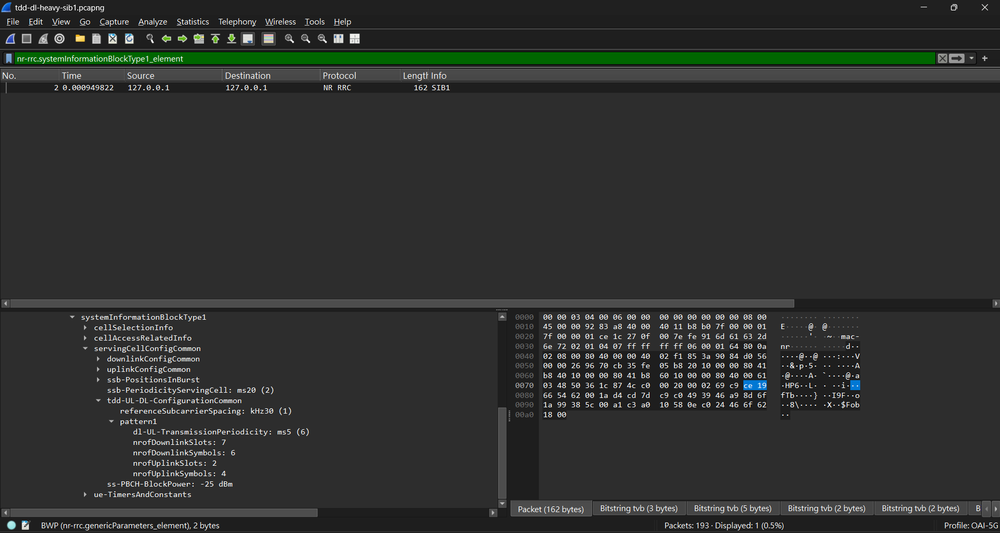


`tdd-balanced-sib1.pcapng`: 

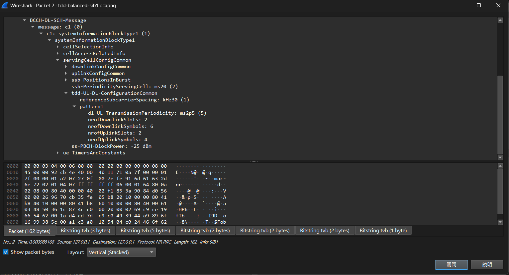
If `pattern2` is present, add another table containing its period and four slot/symbol counts. It uses the same reference SCS.

Take **one screenshot per configuration** showing the selected SIB1 packet and the expanded TDD fields. Include `pattern2` in an additional screenshot if it is present and does not fit.

### 4.4 Draw the TDD Time Allocation

Draw one diagram for DL-heavy and one for balanced. **Use the same 0–5 ms time axis for both diagrams.** Derive each repeating period from SIB1 and repeat the shorter pattern as needed to fill the 5 ms interval. Mark every repeating-period boundary.

A spreadsheet, a drawing tool, or a hand-drawn diagram is acceptable. Include the diagrams as images in your report.

For the normal cyclic prefix used in this exercise, each reference slot contains **14 OFDM symbols**, numbered **0–13**. Use the SIB1 **reference SCS** to construct the common pattern:

| Reference SCS | Reference slot duration |
| --- | ---: |
| 15 kHz | 1 ms |
| 30 kHz | 0.5 ms |
| 60 kHz | 0.25 ms |
| 120 kHz | 0.125 ms |

```text
Number of reference slots in a pattern = Pattern period ÷ Reference slot duration
```

For each pattern:

1. Place `nrofDownlinkSlots` full DL slots at the beginning.
2. If `nrofDownlinkSymbols` is nonzero, mark that many symbols at the beginning of the next slot as DL.
3. Place `nrofUplinkSlots` full UL slots at the end.
4. If `nrofUplinkSymbols` is nonzero, mark that many symbols at the end of the slot immediately before the full UL slots as UL. If there are no full UL slots, use the last slot of the pattern.
5. Mark all remaining symbols as **F (flexible)**. The partial DL and partial UL portions may be in the same slot or in different slots.

Use **D = downlink**, **U = uplink**, and **F = flexible**. Include a legend, the common 0–5 ms time scale, slot indices, and repeating-period boundaries. You may restart the local slot index at zero at each period boundary, but label the boundaries clearly. Expand any mixed slot to show all 14 symbols. Do not automatically label flexible symbols as UL or guard time.

If `pattern2` is present, draw `pattern1` followed by `pattern2`; the combined sequence repeats. Label each pattern boundary and show the full combined duration.

First, count the symbols over **one complete repeating sequence** for each configuration. The two sequences may have different durations, so their raw UL symbol counts alone cannot be used to compare resources per unit time:


```text
Configured DL symbols = 14 × Full DL slots + Partial DL symbols
Configured UL symbols = 14 × Full UL slots + Partial UL symbols
Flexible symbols = Total symbols - Configured DL symbols - Configured UL symbols
Configured UL symbol share (%) = Configured UL symbols ÷ Total symbols × 100
```
balanced_tdd_pattern: <br>
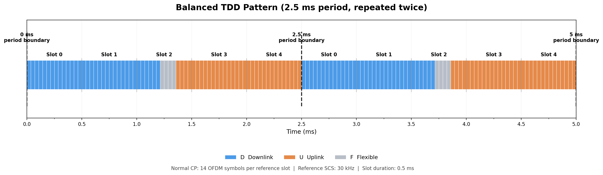

dl_heavy_tdd_pattern: <br>
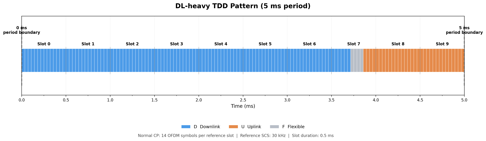


For two patterns, sum the counts and durations of both patterns before calculating the share. These are symbol-count shares of the common configuration, not exact airtime measurements or measured throughput shares.

| TDD setting | Repeating duration (ms) | Total reference slots | DL symbols | UL symbols | Flexible symbols | Configured UL symbol share (%) |
| --- | ---: | ---: | ---: | ---: | ---: | ---: |
| DL-heavy | 5 | 10 | 104 | 32 | 4 | 22.86 |
| Balanced | 2.5 | 5 | 34 | 32 | 4 | 45.71 |

Next, count the symbols over the **same 5 ms interval** shown in your diagrams. Multiply each per-sequence count by the number of complete repetitions in 5 ms. For these captures, 5 ms contains a whole number of repetitions for both configurations.

| TDD setting | Repeating duration (ms) | Repetitions in 5 ms | DL symbols in 5 ms | UL symbols in 5 ms | Flexible symbols in 5 ms |
| --- | ---: | ---: | ---: | ---: | ---: |
| DL-heavy | 5 | 1 | 104 | 32 | 4 |
| Balanced | 2.5 | 2 | 68 | 64 | 8 |

**Question:** Can two patterns have the same UL symbol count per period but provide different numbers of UL symbols per unit time? Explain using your two tables.
- Yes. Both patterns provide 32 configured UL symbols per period, but the DL-heavy period is 5 ms while the balanced period is 2.5 ms. Over the same 5 ms, DL-heavy provides 32 UL symbols (22.86% of its symbols), while balanced repeats twice and provides 64 UL symbols (45.71%).

### 4.5 Connect SIB1 to the Performance Results

Use the supplied mapping between the reference configuration captures and scenarios. Complete this table using Tasks 1–3 and your SIB1 analysis:

| Scenario | Reference TDD setting | JSON traffic direction | Configured UL symbol share (%) | Throughput (Mbps) | Packet loss (%) |
| --- | --- | --- | ---: | ---: | ---: |
| A | DL-heavy | downlink |22.86 |90.654|0.44295|
| B | DL-heavy | uplink| 22.86| 109.117 | 0.23565|
| C | Balanced | uplink|45.71 | 124.416| 2.133|


Answer:

1. Which decoded TDD parameters differ between DL-heavy and balanced?
  - The transmission periodicity differs (5 ms for DL-heavy and 2.5 ms for balanced), as does the number of full downlink slots (7 versus 2). The reference SCS, partial DL/UL symbol counts, full UL slot count, and absence of `pattern2` are the same.
2. Which configuration provides more configured UL symbols per unit time? Support your answer with the diagram and calculated share.
  - Balanced provides more: 64 configured UL symbols per 5 ms versus 32 for DL-heavy. Its configured UL symbol share is 45.71%, compared with 22.86% for DL-heavy.
3. How does that difference help explain the B/C throughput comparison?
  - Scenario C uses the balanced reference setting and measures 124.416 Mbps uplink, while Scenario B uses the DL-heavy reference setting and measures 109.117 Mbps. The greater configured UL opportunity in C is consistent with its higher throughput, but the separate reference captures and other possible radio/test factors mean this comparison does not establish causation.
4. Why can A and B use the same SIB1 TDD configuration even though their traffic directions differ?
  - SIB1 advertises a cell's common TDD configuration; it is not selected separately for each iperf traffic direction. The same DL-heavy pattern can therefore serve both A and B, although it offers fewer configured UL symbols for B's uplink traffic.

> More configured UL resources can provide more opportunities for uplink traffic, but they do not guarantee a proportional throughput increase. Scheduling, radio conditions, overhead, offered traffic, and other radio settings also affect the result. This comparison does not establish that the TDD pattern is the only cause of a performance difference. SIB1 does not show actual slot-by-slot data scheduling. Because the configuration captures were recorded separately, use them as references for the supplied settings, not as independent proof of what was broadcast during each original performance run.

### Optional Observation — PRACH Configuration Index

In the same SIB1, find:

```text
servingCellConfigCommon
  → uplinkConfigCommon
    → initialUplinkBWP
      → rach-ConfigCommon
        → setup
          → rach-ConfigGeneric
            → prach-ConfigurationIndex
```

Wireshark may omit or display the `setup` layer differently. You can also use this display filter, then confirm the field is inside SIB1:

```text
nr-rrc.prach_ConfigurationIndex
```

| TDD setting | SIB1 packet number | PRACH configuration index |
| --- | ---: | ---: |
| DL-heavy |2 |98 |
| Balanced |2 |98|

PRACH is used to send a random-access preamble. Its configuration index is not the DL/UL slot ratio and does not directly explain iperf3 throughput. Equal indices in the two configurations are a valid observation. Drawing PRACH occasions requires additional parameters and the applicable TS 38.211 table; it is outside the required TDD drawing task.

## 7. Task 5 — Is the TDD Setting Suitable?

Complete the table using the supplied scenario mapping, the SIB1 reference configurations from Task 4, and your throughput results:

| Scenario | TDD setting | Traffic direction | Is the setting suitable for this direction? Why? |
| --- | --- | --- | --- |
| A | DL-heavy | Downlink | Yes. More DL resources provide more downlink transmission opportunities.|
| B | DL-heavy | Uplink |No. A DL-heavy setting may limit heavy uplink traffic. |
| C | Balanced | Uplink | Yes. A balanced setting gives uplink traffic more opportunities than the DL-heavy setting in this lab. |

Use these ideas:

- More DL resources provide more downlink transmission opportunities.
- More UL resources provide more uplink transmission opportunities.
- A DL-heavy setting is suitable for downlink traffic.
- A DL-heavy setting may limit heavy uplink traffic.
- A balanced setting gives uplink traffic more opportunities than the DL-heavy setting in this lab.

> The configuration captures show the reference broadcast TDD settings. The iperf3 JSON reports performance; it does not contain TDD parameters. The scenario captures are used for traffic analysis and need not include SIB1.

**Question:** Why might Scenario C achieve better uplink throughput than Scenario B? Refer to your SIB1 diagrams and measured results.
- The balanced reference pattern repeats twice in 5 ms and provides 64 configured UL symbols, compared with 32 in the DL-heavy pattern. This gives C more configured uplink transmission opportunities and is consistent with its measured 124.416 Mbps versus 109.117 Mbps in B, though the reference captures alone cannot prove the TDD pattern caused the difference.
## 8. Task 6 — Find GTP-U Information

Open a **scenario capture** in Wireshark and enter this display filter:

```text
    gtp && ip
```

Choose a packet that contains two IPv4 headers. In the packet details, expand:

1. the first `Internet Protocol Version 4` header;
2. `User Datagram Protocol`;
3. `GPRS Tunneling Protocol`; and
4. the second `Internet Protocol Version 4` header.

Record the following information from one packet:

| Item | Value |
| --- | --- |
| Scenario capture filename |`scenario-a-dl-heavy-downlink.pcapng`|
| Packet number | 1896|
| Outer source IP | 192.168.70.134|
| Outer destination IP | 192.168.70.129|
| Inner source IP | 192.168.70.135|
| Inner destination IP |10.0.0.6 |
| TEID |0xcddc4529 |

Meaning:

- **Outer IP addresses:** The GTP-U tunnel endpoints.
- **Inner IP addresses:** The original UE/application packet.
- **TEID:** Identifies the GTP-U tunnel at the receiving endpoint.

Take one screenshot showing the selected packet and these fields.

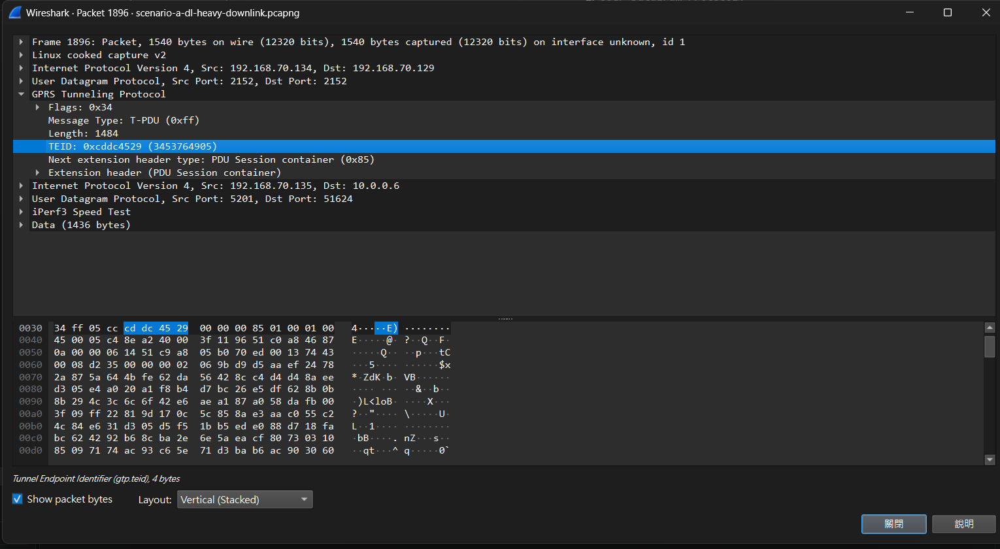

> Some GTP packets are echo or control-related packets. Select one that contains an inner IPv4 packet.

## 9. Task 7 — TCP Retransmissions

Use the **scenario captures** for this task.

The performance traffic is UDP, but iperf3 also uses a small TCP control connection.

Apply this Wireshark filter:

```text
tcp.analysis.retransmission
```

Record the number of displayed packets:

| Scenario | Displayed TCP retransmissions |
| --- | ---: |
| A |14 |
| B | 12|
| C | 12|

Scenario A
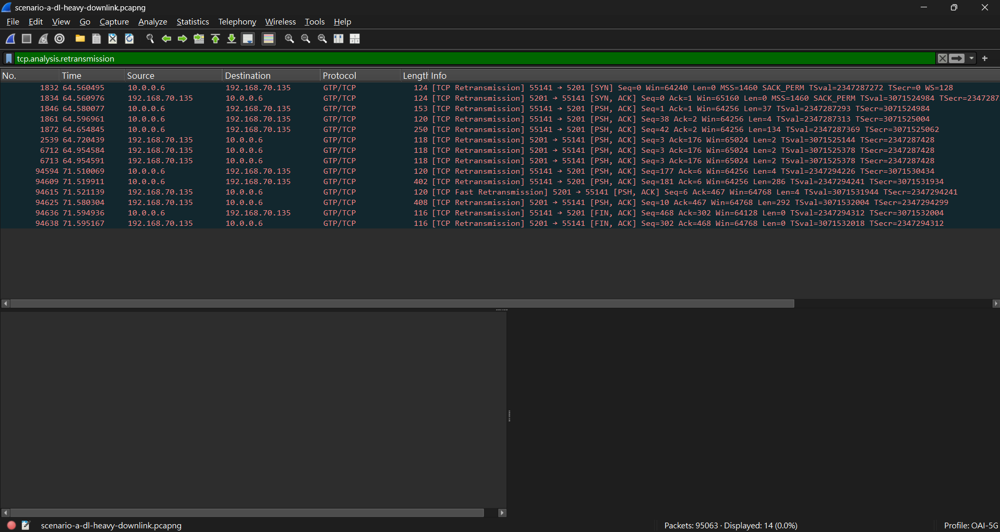

Scenario B
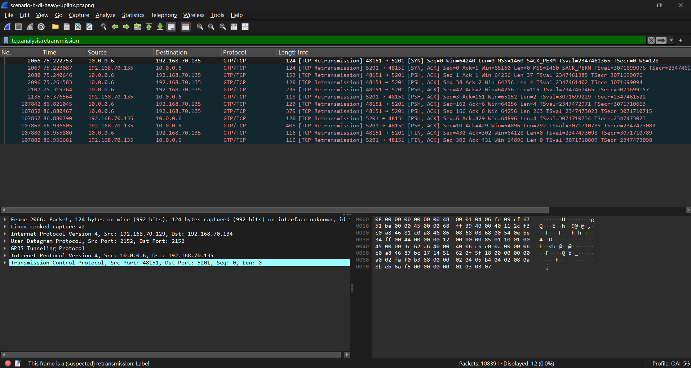

Scenario C
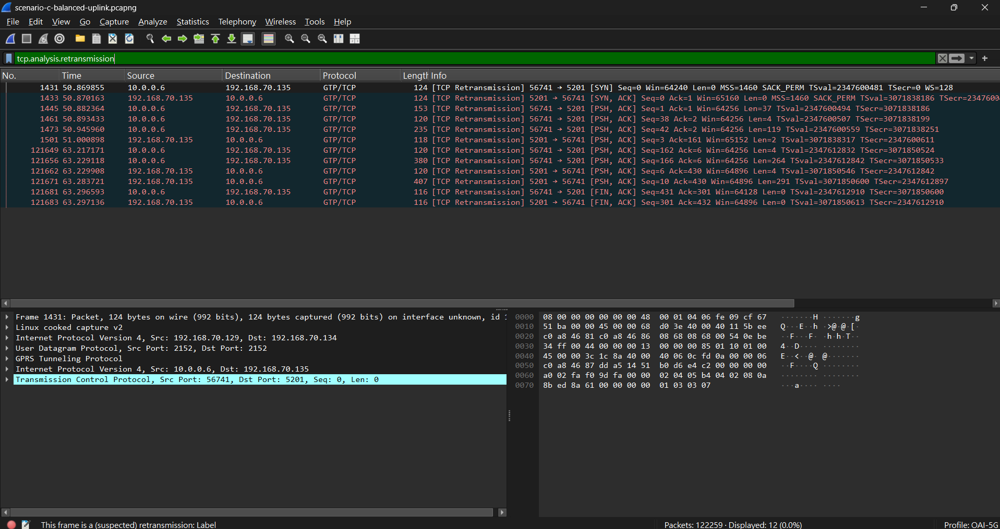

> Report the number displayed by Wireshark using the specified filter. Counts may vary with Wireshark analysis settings. Include screenshots showing the filter and displayed count for each scenario. The filter includes any TCP flows that Wireshark can decode in the capture; a displayed retransmission is not, by itself, proof of loss in the UDP test.

**Question:** Do these TCP retransmissions directly represent lost UDP performance packets?
- No. These retransmissions belong to TCP control traffic, while the iperf3 performance stream is UDP; TCP retransmission counts do not directly measure UDP packet loss. Use the iperf3 UDP `lost_percent` values for the UDP loss comparison.

## 10. Task 8 — RTT and Packet Interval

Use a **scenario capture** for both parts of this task.

### TCP RTT

Apply:

```text
tcp.analysis.ack_rtt
```

Select one packet from the iperf3 TCP control connection and record its ACK RTT:

| Scenario | Packet number | Example TCP ACK RTT |
| --- | ---: | --- |
| A | 2535|18.635 ms |
| B |2132|17.068 ms|
| C |1474|11.704 ms |

This value is the RTT of the TCP control connection. It is not the RTT of the UDP data packets.

### Packet Interval

Apply a display filter to select UDP data packets from the same flow.

Select two consecutive, distinct UDP data packets in the filtered packet list. Avoid duplicated observations caused by merged captures; use the same capture point/interface when possible.

In the packet details of the second packet, find:

```text
Time delta from previous displayed frame
```

Record the scenario, display filter, packet numbers, and time interval.

| Scenario | Display filter | Packet numbers | Time interval |
| --- | --- | --- | --- |
| `scenario-a-dl-heavy-downlink.pcapng`|udp.time_delta | 2582 | 127 ms|
|`scenario-b-dl-heavy-uplink.pcapng` |udp.time_delta|1472 | 50.485 ms|
| `scenario-c-balanced-uplink.pcapng`| udp.time_delta| 1509| 942 ms|

`scenario-a-dl-heavy-downlink.pcapng`: <br>
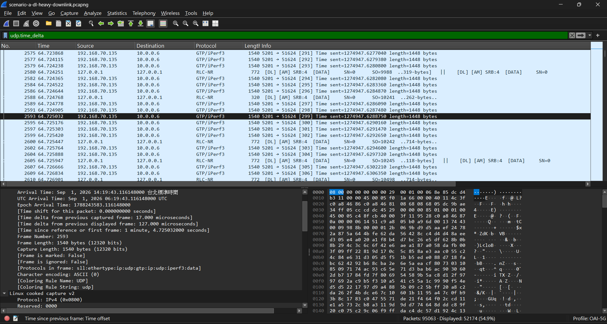

`scenario-b-dl-heavy-uplink.pcapng`: <br>
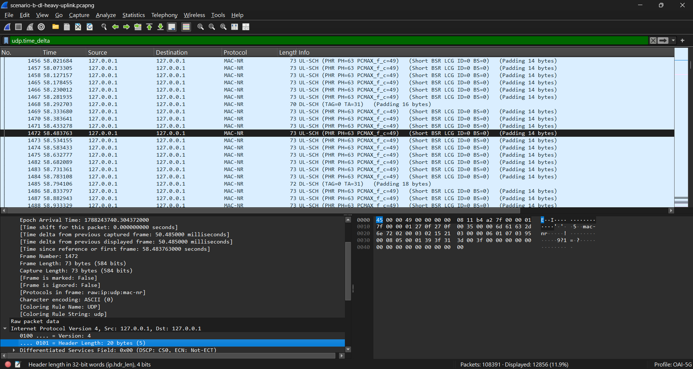

`scenario-c-balanced-uplink.pcapng`: <br>
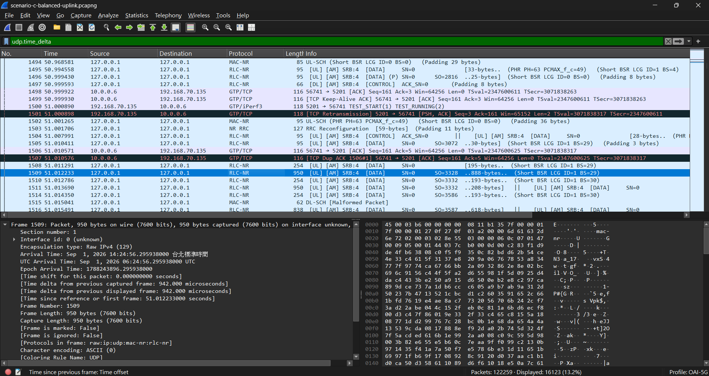

**Note:** The time interval depends on the applied display filter. Make sure the selected packets are distinct data packets, not duplicated observations from different capture points. Do not use their interval to infer the TDD slot pattern.

## 11. Final Questions

Answer each question in two or three sentences:

1. Does Scenario A use a TDD setting that matches its traffic direction?
- Yes. Scenario A is downlink, and its DL-heavy reference configuration provides 104 DL symbols and 32 UL symbols per 5 ms period, so the configuration favors its traffic direction.
2. Why is Scenario B expected to have limited uplink resources? Cite a parameter or count from the DL-heavy SIB1 reference configuration.
- The DL-heavy pattern has a 5 ms period with 2 full UL slots and 4 additional UL symbols, for 32 configured UL symbols out of 140 total symbols (22.86%). This is fewer UL symbols per unit time than the balanced reference pattern.
3. How much does uplink throughput change from B to C?
- It increases by 15.299 Mbps, from 109.117 Mbps in B to 124.416 Mbps in C. This is an increase of approximately 14.02% relative to B.
4. What negative result, if any, is visible in C? Support your answer with packet loss or jitter values.
- C has higher packet loss and jitter than B: 2.133% and 0.1620 ms, compared with 0.23565% and 0.11619 ms in B. Thus, the throughput gain is accompanied by worse loss and jitter in these runs.
5. Why can increasing UL resources improve uplink throughput?
- Uplink data can be scheduled in UL symbols and, when the scheduler assigns them for uplink, flexible symbols. More configured uplink opportunities can let the gNB schedule more UE data, although throughput also depends on radio conditions, scheduling, and other factors.
6. Is adding more UL resources always the best solution? Explain using throughput and packet loss.
- No. C gains about 14.02% throughput over B, but its packet loss rises from 0.23565% to 2.133% and its jitter also increases. The preferred setting depends on whether the throughput gain is worth the observed reliability trade-off.
7. Suggest one simple follow-up test that could improve throughput without producing too much packet loss.
- Test one intermediate TDD configuration between DL-heavy and balanced, keeping the UE, channel, offered UDP rate, test duration, and other settings unchanged. Repeat the test and compare throughput, packet loss, and jitter to find a setting that raises throughput without an unacceptable loss increase.
8. What can the configuration captures tell you that the iperf3 JSON cannot? Why are separately recorded configuration captures not direct proof of the configuration during an earlier test?
- The configuration captures show the broadcast SIB1 TDD parameters, such as periodicity and DL/UL slot and symbol counts; the iperf3 JSON reports traffic direction and measured performance instead. Because the configuration captures were recorded separately, they document reference settings but do not prove that the same configuration was active during an earlier performance run.

## 12. Submission Checklist

Submit one Markdown file containing:

- the completed direction table;
- the throughput table and B-to-C calculation;
- the B/C packet-loss and jitter table;
- the SIB1 TDD parameter table, including filenames and packet numbers;
- one SIB1 TDD screenshot per configuration, plus `pattern2` screenshots if needed;
- two TDD diagrams: DL-heavy and balanced, with D/U/F labels and mixed-slot symbol details;
- the per-sequence symbol-count / UL-share table, the common 5 ms comparison table, and the configuration-to-performance table;
- the Task 4.5 answers and the TDD suitability table;
- one GTP-U screenshot and its completed table;
- the TCP retransmission counts and screenshots;
- one TCP ACK RTT example;
- one packet-interval example; and
- answers to the final questions.

The PRACH observation is optional and carries no required points. Include all referenced image files alongside the Markdown file, or submit a ZIP containing the report and images.

## 13. Grading Rubric

| Item | Points |
| --- | ---: |
| Traffic direction | 5 |
| Throughput values and calculation | 20 |
| B/C packet-loss and jitter comparison | 15 |
| SIB1 TDD parameter extraction and screenshot evidence | 10 |
| TDD diagrams, symbol counts, and UL shares | 10 |
| TDD suitability and connection to measured performance | 10 |
| GTP-U fields and screenshot | 15 |
| TCP retransmission, RTT, and packet interval | 10 |
| Clear final answers | 5 |
| **Total** | **100** |

## References

These references support the field names and interpretation. Reading the full specifications is not required.

- [Wireshark NR RRC display filter reference](https://www.wireshark.org/docs/dfref/n/nr-rrc.html): SIB1 and TDD display-filter fields.
- [3GPP TS 38.331, Release 18](https://www.etsi.org/deliver/etsi_ts/138300_138399/138331/18.08.00_60/ts_138331v180800p.pdf): SIB1, TDD-UL-DL-ConfigCommon, and TDD-UL-DL-Pattern definitions.
- [3GPP TS 38.213, Release 17, Section 11.1](https://www.etsi.org/deliver/etsi_ts/138200_138299/138213/17.06.00_60/ts_138213v170600p.pdf): Interpretation of common TDD slot and symbol allocation.