# Lab 0: Basic wireshark operation and capture
- [Lab 0: Basic wireshark operation and capture](#lab-0-basic-wireshark-operation-and-capture)
  - [1.Wireshark Installation Guide (Windows)](#1wireshark-installation-guide-windows)
  - [2. Capture packets: access the NTUST homepage (https://www.ntust.edu.tw/home.php)](#2-capture-packets-access-the-ntust-homepage-httpswwwntustedutwhomephp)
    - [2.1 What is the IP address and port of the NTUST homepage (https://www.ntust.edu.tw/home.php)?](#21-what-is-the-ip-address-and-port-of-the-ntust-homepage-httpswwwntustedutwhomephp)
    - [2.2 What is the IP address and port of your PC when initially accessing the page?](#22-what-is-the-ip-address-and-port-of-your-pc-when-initially-accessing-the-page)
    - [2.3 What is the process of the TCP three-way handshake?](#23-what-is-the-process-of-the-tcp-three-way-handshake)
  - [3. Use the filter dns to find a DNS packet](#3-use-the-filter-dns-to-find-a-dns-packet)
    - [3.1 What is the IP address and port of the DNS server?](#31-what-is-the-ip-address-and-port-of-the-dns-server)
    - [3.2 What is the domain name in this query?](#32-what-is-the-domain-name-in-this-query)
    - [3.3 Which protocol(s) does this DNS packet use? (List the protocols from Layer 2 — Link Layer — up to Layer 5 — Application Layer in the TCP/IP five-layer model.)](#33-which-protocols-does-this-dns-packet-use-list-the-protocols-from-layer-2--link-layer--up-to-layer-5--application-layer-in-the-tcpip-five-layer-model)
  - [4. Access an HTTP page and answer the following questions:](#4-access-an-http-page-and-answer-the-following-questions)
    - [4.1 Which HTTP page did you access?](#41-which-http-page-did-you-access)
    - [4.2 What is the IP address and port of the server hosting this page?](#42-what-is-the-ip-address-and-port-of-the-server-hosting-this-page)
    - [4.3 What is the request method?](#43-what-is-the-request-method)
    - [4.4 What is the response status code, and what does it mean?](#44-what-is-the-response-status-code-and-what-does-it-mean)
  - [Lab 1](#lab-1)
- [Lab 1: Analyzing UE–gNB Connectivity in an OAI 5G SA Network(Student)](#lab-1-analyzing-uegnb-connectivity-in-an-oai-5g-sa-networkstudent)
  - [1. Lab Overview](#1-lab-overview)
    - [Learning objectives](#learning-objectives)
  - [2. Required Files](#2-required-files)
  - [3. Install the OAI-5G Wireshark Profile](#3-install-the-oai-5g-wireshark-profile)
    - [3.1 Ubuntu or Linux](#31-ubuntu-or-linux)
    - [3.2 Windows](#32-windows)
  - [4. Open and Verify the Capture](#4-open-and-verify-the-capture)
    - [Checkpoint 1: Wireshark Setup — 10 points](#checkpoint-1-wireshark-setup--10-points)
  - [](#)
  - [5. Identify the Basic 5G SA Architecture](#5-identify-the-basic-5g-sa-architecture)
    - [Checkpoint 2: Basic Architecture](#checkpoint-2-basic-architecture)
  - [6. Analyze the RRC Connection Establishment](#6-analyze-the-rrc-connection-establishment)
    - [Checkpoint 3: RRC Connection Establishment](#checkpoint-3-rrc-connection-establishment)
  - [7. Connect RRC Signaling to NGAP and NAS](#7-connect-rrc-signaling-to-ngap-and-nas)
    - [Checkpoint 4: RRC-to-NGAP/NAS Mapping](#checkpoint-4-rrc-to-ngapnas-mapping)
  - [8. Verify the UE IP Address and User-Plane Traffic](#8-verify-the-ue-ip-address-and-user-plane-traffic)
    - [Checkpoint 5: UE IP and User Plane — 15 points](#checkpoint-5-ue-ip-and-user-plane--15-points)
  - [9. Final UE Connection Sequence](#9-final-ue-connection-sequence)
    - [Checkpoint 6: Final Sequence Diagram — 5 points](#checkpoint-6-final-sequence-diagram--5-points)
  - [10. Submission and Grading](#10-submission-and-grading)

## 1.Wireshark Installation Guide (Windows)
Go to [wireshark website](https://www.wireshark.org/download.html) and choose version to download 

Choose Components you want to install\
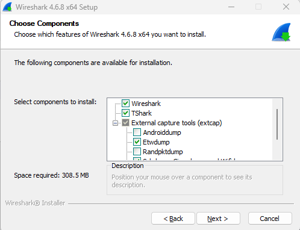

Creat the icon in desktop\
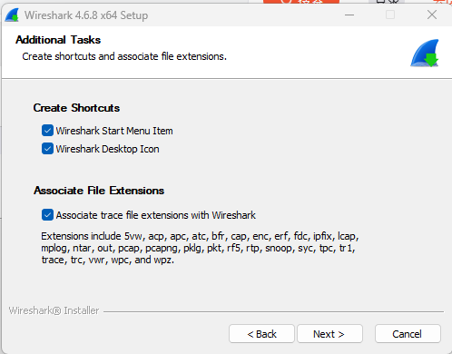

Install Npcap (In this PC is already have)\
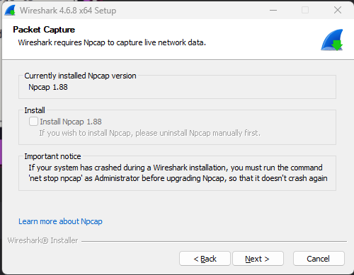

Install USBPcap and wireshark\
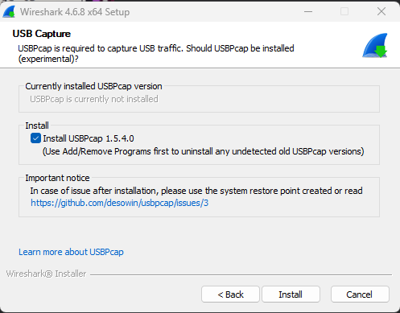

Reboot PC\
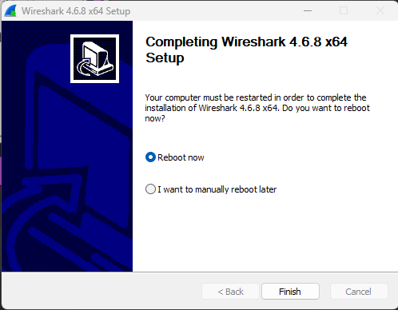

## 2. Capture packets: access the NTUST homepage (https://www.ntust.edu.tw/home.php)


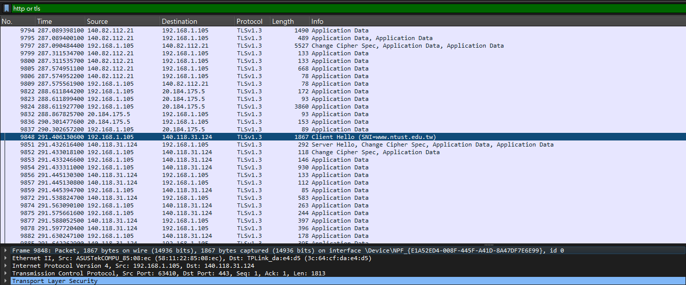

### 2.1 What is the IP address and port of the NTUST homepage (https://www.ntust.edu.tw/home.php)?

- IP adress is `140.118.31.124`, port is `443` (from Dst Port).

### 2.2 What is the IP address and port of your PC when initially accessing the page?

- IP adress is `192.168.1.105`, port is `63410` (from Src Port).

### 2.3 What is the process of the TCP three-way handshake?
- SYN: Client sends SYN to server.\
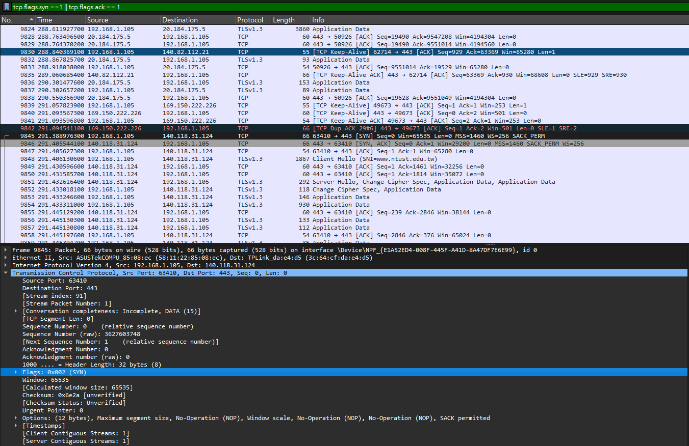

- SYN-ACK: Server replies with SYN-ACK.\
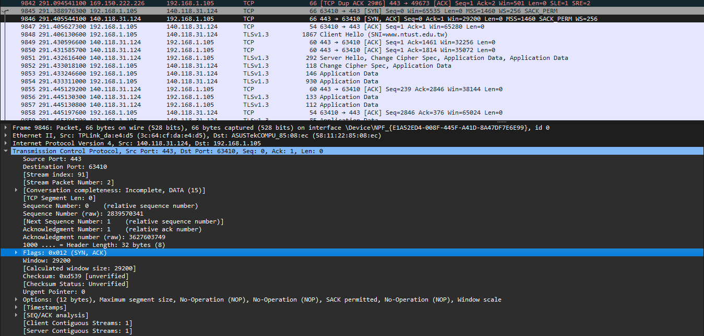

- ACK: Client sends ACK. Connection established.\
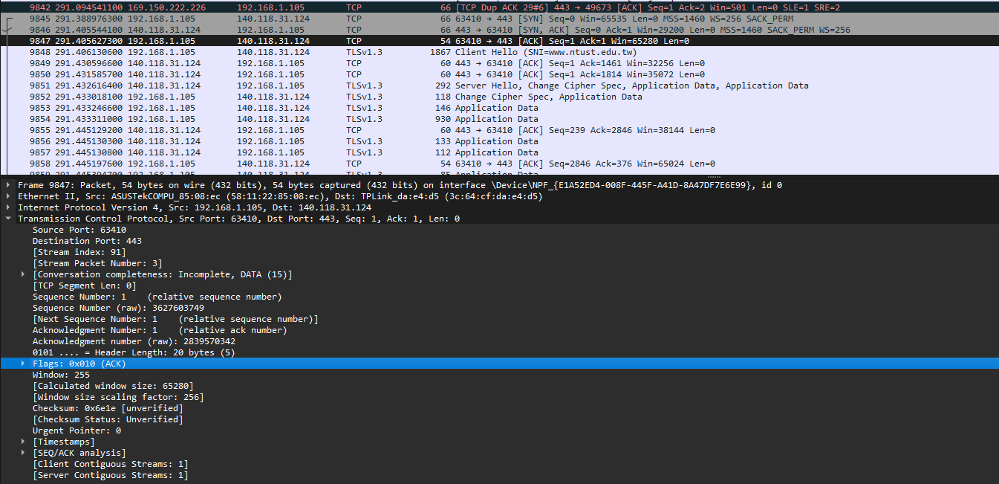


## 3. Use the filter dns to find a DNS packet

Interestingly, if you use Brave as your browser, you might not be able to catch `dns` packets because of its default settings.\
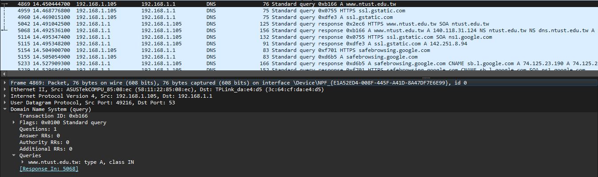

### 3.1 What is the IP address and port of the DNS server?
- IP adress is `192.168.1.1`, port is `53` (from Dst Port).

### 3.2 What is the domain name in this query?

- The domain name in the query is [www.ntust.edu.tw](https://www.ntust.edu.tw/)

### 3.3 Which protocol(s) does this DNS packet use? (List the protocols from Layer 2 — Link Layer — up to Layer 5 — Application Layer in the TCP/IP five-layer model.)

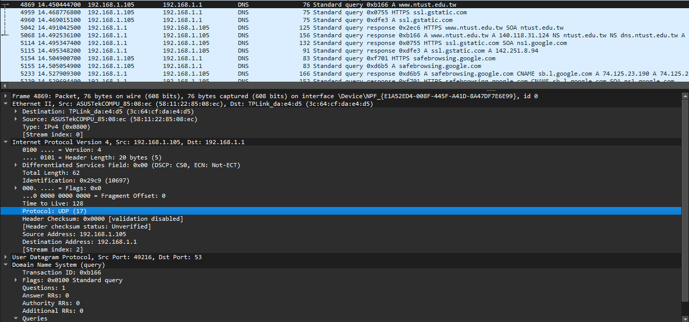

- Layer 2 (Link Layer): Ethernet II
- Layer 3 (Network Layer): Internet Protocol Version 4 (IPv4)
- Layer 4 (Transport Layer): User Datagram Protocol (UDP)
- Layer 5 (Application Layer): Domain Name System (DNS)

## 4. Access an HTTP page and answer the following questions:

### 4.1 Which HTTP page did you access?
- http://www.gzxyzn.com/Article/bjrk2/1644.html

### 4.2 What is the IP address and port of the server hosting this page?

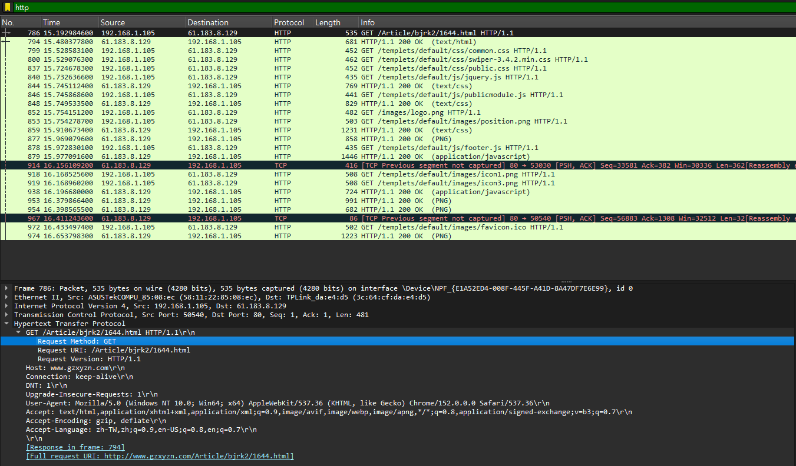

- IP adress: `61.183.8.129`, port is 80 (from Dst Port).
### 4.3 What is the request method?
- GET
### 4.4 What is the response status code, and what does it mean?

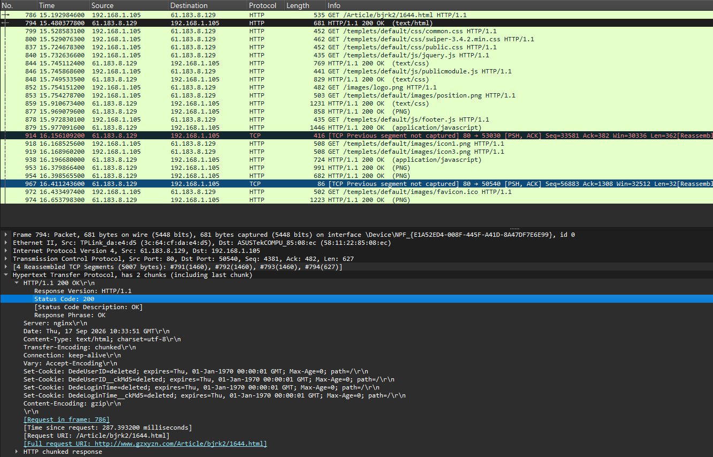
- As we can see, a lot of packet showing that
```
HTTP/1.1 200 OK
```
The number of 200 is the `response status code`.

More explaination of `response status code` can see here [[Link]](https://developer.mozilla.org/en-US/docs/Web/HTTP/Reference/Status).


---

## Lab 1
# Lab 1: Analyzing UE–gNB Connectivity in an OAI 5G SA Network(Student)

## 1. Lab Overview

In this lab, you will use Wireshark to analyze how a UE establishes an RRC connection with an OAI gNB and then registers with the 5G Core.

The main signaling path is:

```text
UE
→ RRC connection establishment
→ NAS Registration Request
→ gNB forwards the NAS message through NGAP
→ 5G Registration
→ PDU Session establishment
→ UE obtains an IP address
→ User-plane connectivity test
```

This lab focuses on the relationship between the UE and gNB. Internal 5G Core procedures such as detailed SBI and PFCP signaling are outside the main scope.

### Learning objectives

After completing this lab, you should be able to:

1. Identify the UE, gNB, AMF, UPF, and Data Network.
2. Explain the purpose of `RRCSetupRequest`, `RRCSetup`, and `RRCSetupComplete`.
3. Explain how a NAS message is transported from the UE to the AMF through the gNB.
4. Identify the main 5G Registration messages.
5. Verify that the UE receives an IP address and exchanges user-plane traffic.

## 2. Required Files

You need the following files:

- `OAI-5G-Wireshark-Profile.zip`
- `oai-5g-combined.pcapng`
- reference:[file](https://drive.google.com/drive/u/0/folders/1Fc2A4VpYRiw1P1k6ZjbW1Ced06ihUY4D)

The capture contains both:

- OAI-generated RAN packets for MAC-NR and NR-RRC analysis
- Core-network packets for NGAP, NAS-5GS, GTP-U, and ICMP analysis

---

## 3. Install the OAI-5G Wireshark Profile

### 3.1 Ubuntu or Linux

Close Wireshark and extract the profile:

```bash
mkdir -p "$HOME/.config/wireshark/profiles"

unzip OAI-5G-Wireshark-Profile.zip \
  -d "$HOME/.config/wireshark/profiles"
```

Verify the profile directory:

```bash
ls "$HOME/.config/wireshark/profiles/OAI-5G"
```

### 3.2 Windows

1. Close Wireshark.
2. Press `Win + R`.
3. Enter `%APPDATA%\Wireshark\profiles`.
4. Create the `profiles` directory if it does not exist.
5. Extract the ZIP file into that directory.

The final directory should look like:

```text
%APPDATA%\Wireshark\profiles\OAI-5G\preferences
%APPDATA%\Wireshark\profiles\OAI-5G\enabled_protos
%APPDATA%\Wireshark\profiles\OAI-5G\disabled_protos
%APPDATA%\Wireshark\profiles\OAI-5G\heuristic_protos
```

Do not add an extra directory level around `OAI-5G`.

## 4. Open and Verify the Capture

1. Start Wireshark.
2. Select `Edit → Configuration Profiles → OAI-5G`.
3. Open `oai-5g-combined.pcapng`.
4. Enter this display filter:

```wireshark
nr-rrc
```

You should see NR RRC messages.

If packets are incorrectly displayed as TP-Link traffic, verify:

```text
Edit → Preferences → Protocols → UDP
→ Enable “Try heuristic sub-dissectors first”

Analyze → Enabled Protocols
→ Enable mac_nr_udp
→ Disable tplink-smarthome
```

> The RAN packets appear as `127.0.0.1:9999 → 127.0.0.1:9999`. These are synthetic packets generated by OAI for Wireshark analysis. They are not the actual network addresses of the UE and gNB.

### Checkpoint 1: Wireshark Setup — 10 points

Submit:

- A screenshot showing that the `OAI-5G` profile is selected. — 3 points
- 

- A screenshot showing the opened capture. — 2 points
- A screenshot showing NR RRC packets after applying `nr-rrc`. — 5 points

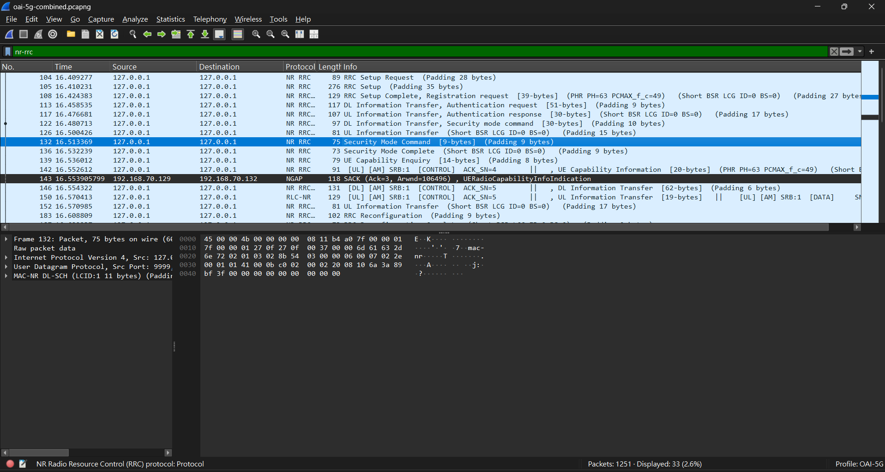
---

## 5. Identify the Basic 5G SA Architecture

Use:

```text
Statistics → Endpoints → IPv4
```

Apply these filters individually:

```wireshark
ngap
```

```wireshark
gtp
```

```wireshark
icmp
```

Complete the table:

| Component | IP address | Evidence from the capture |
|---|---|---|
| UE PDU address | `10.0.0.2` |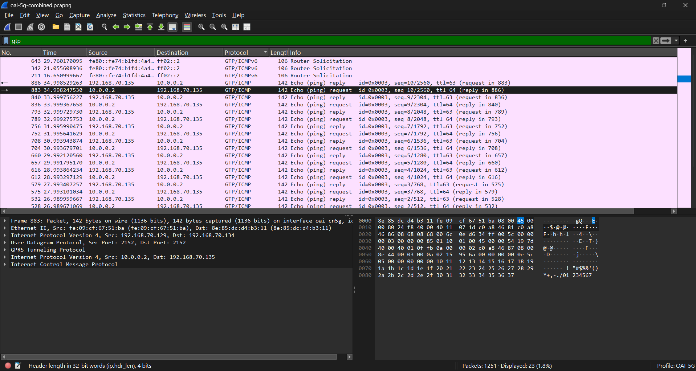|
| gNB | `192.168.70.129` |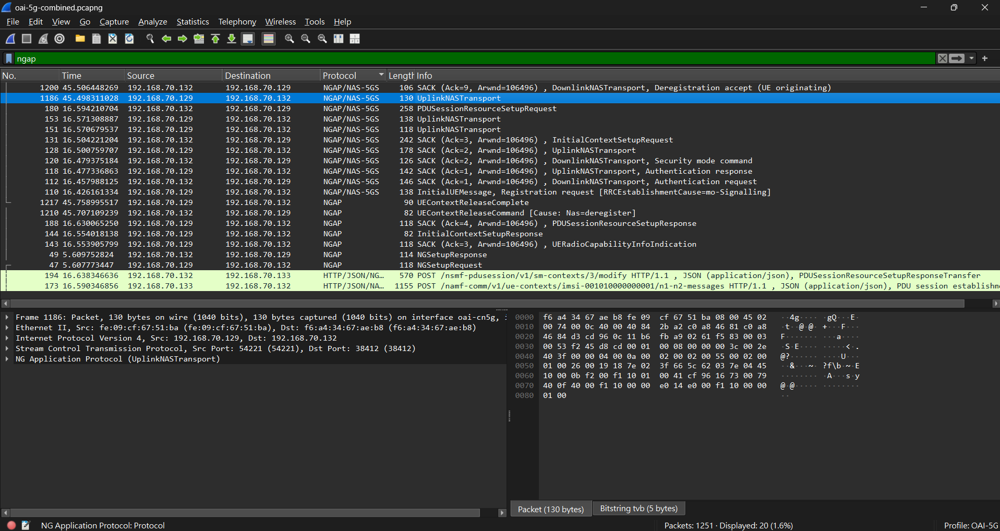 |
| AMF | `192.168.70.132` ||
| UPF | `192.168.70.134` |  |
| Data Network | `192.168.70.135` |  |

Complete the interface table:

| Interface | Connected components | Main protocol | Purpose |
|---|---|---|---|
| N1 | AMF - UE  | RRC |  |
| N2 | AMF - RAN | NGAP | Control plane:  |
| N3 |  UPF - RAN  | GTP-U | User plane:  |

The logical architecture is:

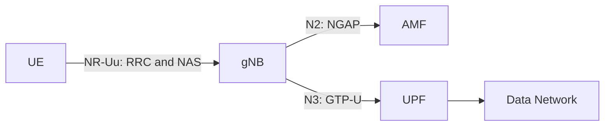

### Checkpoint 2: Basic Architecture 

- Correctly identify the five components and their IP addresses. 
- Correctly explain N1, N2, and N3. 

---

## 6. Analyze the RRC Connection Establishment

Apply:

```wireshark
nr-rrc
```

Find the following messages in order:

1. `RRCSetupRequest`
2. `RRCSetup`
3. `RRCSetupComplete`

You may also try these specific filters:

```wireshark
nr-rrc.rrcSetupRequest_element
```

```wireshark
nr-rrc.rrcSetup_element
```

```wireshark
nr-rrc.rrcSetupComplete_element
```

Complete the table:

| Message | Direction | Logical channel / SRB | Main purpose | Packet number |
|---|---|---|---|---:|
| RRCSetupRequest | UE to gNB | UL-CCCH/SRB0 | Before connection | No.104 |
| RRCSetup | gNB to UE | DL-CCCH/SRB0 | gNB set up SRB1 | No.105 |
| RRCSetupComplete | UE to gNB | UL-CCCH/SRB1 | After setting up | No.108 |

Answer the following questions:

1. What is the establishment cause in `RRCSetupRequest`?
- When UE want to connect to internet.
2. What SRB does `RRCSetupRequest` use? Why?
- 
3. Which side sends `RRCSetup`?
- gNB 
4. Which signaling radio bearer is used after the RRC connection is established?
- SRB1
5. Which NAS message is carried inside `RRCSetupComplete`?
- 
6. At the end of this procedure, is the UE only connected to the gNB, or is it already registered with the 5G Core? Explain.
- No, when the procedure is finish, it means UE only can communicate with gNB, but UE haven't connect to AMF (Core Network), UE must finish the `NAS-PDU Registration Request` so that UE can accepted by 5GC.

### Checkpoint 3: RRC Connection Establishment 

- Identify all three RRC messages with packet numbers and screenshots. 
- Correctly identify message directions. 
- Correctly identify UL-CCCH, DL-CCCH, SRB0, and SRB1 usage.
- Explain the purpose of each message.
- Explain the difference between RRC connection and 5G Registration. 

---

## 7. Connect RRC Signaling to NGAP and NAS

The UE exchanges NAS signaling with the AMF through the gNB. On the radio side, the NAS message is carried by RRC. The gNB then forwards it to the AMF through NGAP.

First, locate `RRCSetupComplete` using:

```wireshark
nr-rrc
```

Expand:

```text
RRCSetupComplete
→ dedicatedNAS-Message
→ Registration Request
```

Then apply:

```wireshark
ngap && nas-5gs
```

Locate:

```text
InitialUEMessage
→ NAS-PDU
→ Registration Request
```

Compare the two packets:

| Stage | Protocol message | Sender → receiver | Encapsulated information |
|---|---|---|---|
| Radio side | RRCSetupComplete | UE → gNB  | Message type: Registration request (0x41) |
| Core side | NGAP InitialUEMessage | gNB → AMF | Message type: Registration request (0x41) |

Finally, locate:

- Registration Accept
- Registration Complete

Answer:

1. What is the role of the gNB when it transports NAS messages?
2. What is the difference between RRC and NAS signaling?
3. Is the Registration Request delivered directly from the UE to the AMF? Explain the protocol path.
4. Which message confirms that Registration has completed successfully?

### Checkpoint 4: RRC-to-NGAP/NAS Mapping 

- Show the Registration Request inside `RRCSetupComplete`. 
- Show the Registration Request inside NGAP `InitialUEMessage`. 
- Correctly complete the mapping table. 
- Explain the roles of RRC, NGAP, NAS, gNB, and AMF. 
- Identify Registration Accept and Registration Complete. 

---

## 8. Verify the UE IP Address and User-Plane Traffic

Apply:

```wireshark
nas-5gs || ngap
```

Find the PDU Session Establishment Accept and record the UE address:

| Field | Observed value |
|---|---|
| UE IPv4 address | `10.0.0.2` |

Apply:

```wireshark
gtp || icmp
```

Find one ICMP Echo Request and its Echo Reply. Confirm that the UE's IP packet is carried inside GTP-U between the gNB and UPF.

Answer:

1. What IPv4 address was assigned to the UE?
2. How many ICMP Echo Request/Reply pairs are present?
3. What does the successful Echo Reply prove about the UE connection?

### Checkpoint 5: UE IP and User Plane — 15 points

- Identify the UE IPv4 address in the PDU Session Establishment Accept. — 6 points
- Show one ICMP Echo Request and its Echo Reply. — 5 points
- Explain what the successful ping proves. — 4 points

---

## 9. Final UE Connection Sequence

Create one sequence diagram containing:

- UE
- gNB
- AMF
- UPF
- Data Network

Include at least:

1. RRCSetupRequest
2. RRCSetup
3. RRCSetupComplete with Registration Request
4. NGAP InitialUEMessage
5. Authentication
6. Security Mode
7. Registration Accept and Complete
8. PDU Session establishment
9. GTP-U ping

You may use:

```text
Statistics → Flow Graph → Displayed packets
```

However, the OAI RAN packets use loopback addresses. Manually separate the UE and gNB in your final diagram according to the RRC message direction.

### Checkpoint 6: Final Sequence Diagram — 5 points

- Include the required components and signaling stages. — 3 points
- Clearly distinguish control-plane and user-plane traffic. — 2 points

---

## 10. Submission and Grading

Submit one PDF or Markdown report containing:

- Completed tables
- Answers to all questions
- Packet numbers
- Required screenshots
- Final sequence diagram

Each screenshot must show:

- The display filter
- Packet number
- Info column
- Expanded protocol fields supporting your answer

| Checkpoint | Topic | Points |
|---:|---|---:|
| 1 | Wireshark profile and NR-RRC decoding | 10 |
| 2 | Basic 5G SA architecture | 10 |
| 3 | RRC connection establishment | 35 |
| 4 | RRC-to-NGAP/NAS mapping | 25 |
| 5 | UE IP and GTP-U user plane | 15 |
| 6 | Final sequence diagram | 5 |
|  | **Total** | **100** |


